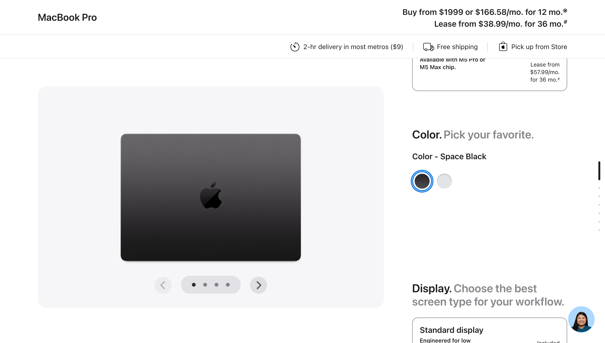
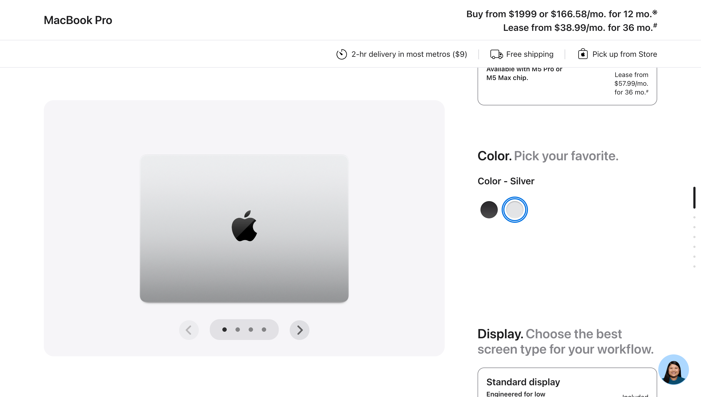

## Notes

The before and after captures are shown below.

Only the public color selector was used. No delivery ZIP, account details, payment information, or purchase action was entered. The preview change is directly visible; dependent chip and display configuration remain untested because those controls were disabled.
