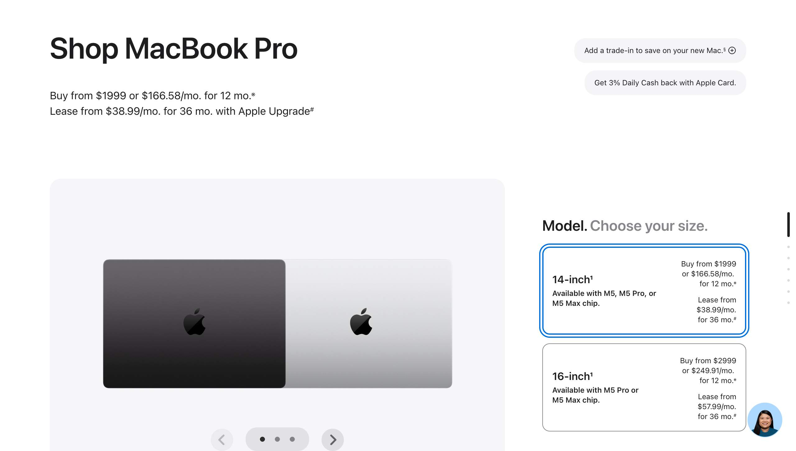
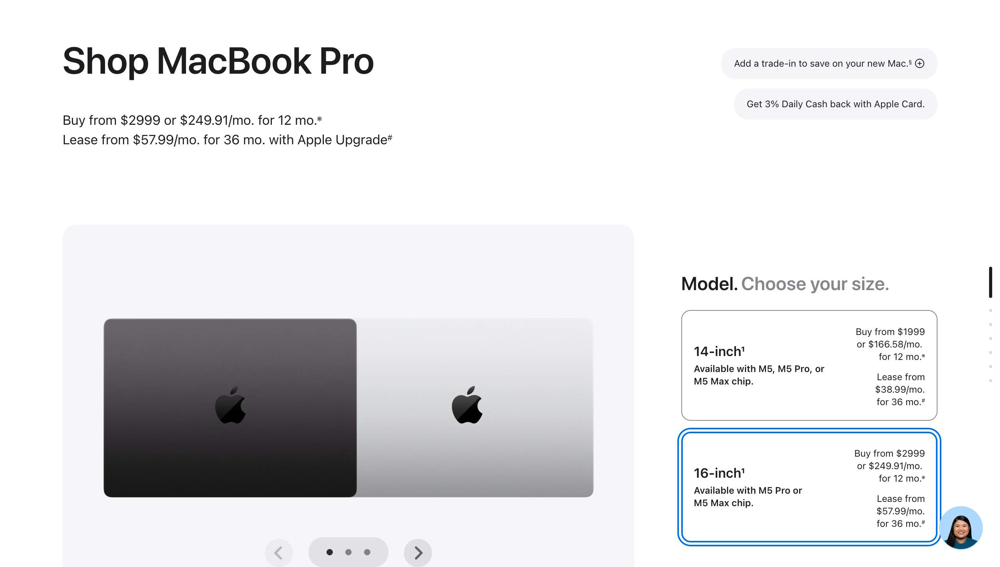
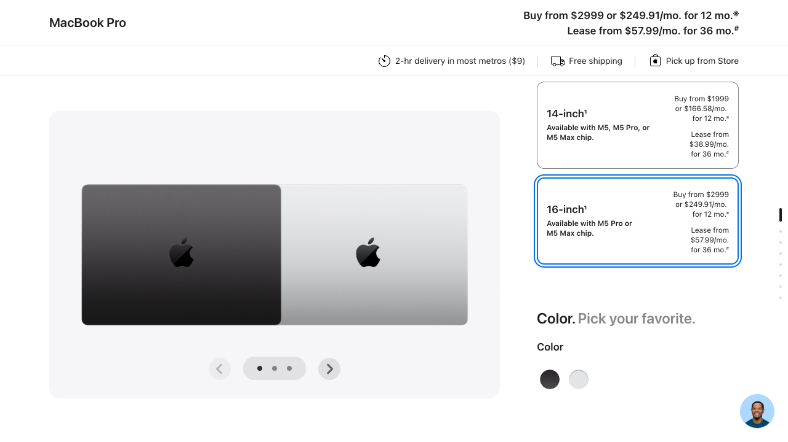

## Notes

The 14-to-16-inch model change and its reverse-and-repeat were captured from equivalent selections. The before and after screenshots show the model card, gallery image, and purchase summary. The transition reproduced with Chrome DevTools MCP and an isolated Playwright session. The native size radio is visually hidden, so each browser automation activated its associated label. No ZIP, account information, or purchase action was entered. Dependent Chip and Display choices remained untested because they were disabled.

